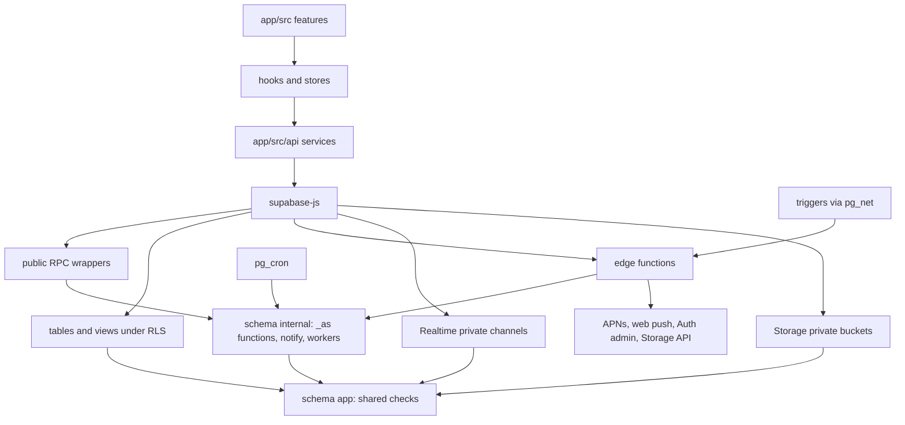
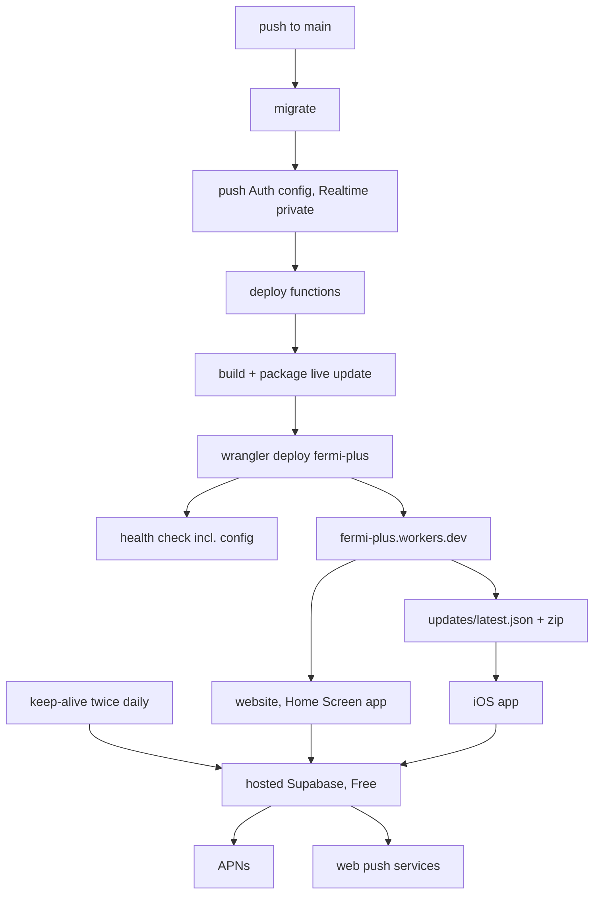
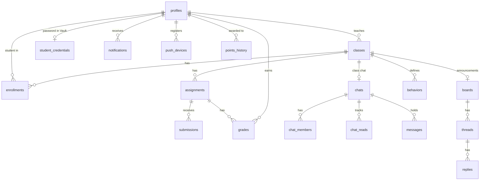

# Architecture Spine — Capacitor Supabase Port

## Design Paradigm

**Policy-in-the-database client-server.** Supabase Postgres is the application server: every rule about who may read or change what lives in row-level security policies and SQL functions. The Capacitor app is a thin client; hiding something in the UI is convenience, never protection. Edge functions are ports to what Postgres cannot reach (APNs, web push, the Auth admin API, the Storage API).



Arrows are the only allowed dependency directions. Only `app/src/api/` imports the Supabase client. Schemas `app` and `internal` are not exposed by the Data API.

## Invariants & Rules

### AD-1 — The database is the only enforcer [ADOPTED]

- **Binds:** all epics; K4, K5
- **Prevents:** access checked in the app or an edge function while another path trusts the database, which is how Firebase's holes formed (parity inventory, defects table)
- **Rule:** every read and write a user can make is decided by an RLS policy, a column grant or a function that checks before it acts. Every table in `public` has RLS on in the migration that creates it. Client-side checks only shape the UI. Recipients, membership and visibility are computed in SQL only; edge functions never re-derive them in TypeScript.

### AD-2 — Each relationship check is written once, in schema `app` [ADOPTED]

- **Binds:** all epics; owners in the Epic Map
- **Prevents:** two epics defining "enrolled", "teaches" or "in chat" differently; recursive policies; hand-joined membership in functions
- **Rule:** relationships are `stable security definer` functions with `set search_path = ''` in schema `app`. Each takes explicit people (`app.teaches_student(teacher_id, student_id)`), with a one-argument form that passes `auth.uid()`. Policies, storage policies, Realtime policies and functions call these and never re-join membership tables. A predicate is owned by the epic that owns the table it reads. Their meaning is fixed here:

| Predicate | True when | Archived class | After removal |
| --- | --- | --- | --- |
| `app.my_role()` | the caller's `profiles.role` | n/a | n/a |
| `app.is_admin(u)` | `u` has role `admin` | n/a | n/a |
| `app.teaches(t, class)` | `t` owns the class | true | n/a |
| `app.enrolled(s, class)` | an enrollment row exists | true | false |
| `app.class_open(class)` | the class is not archived | false | n/a |
| `app.teaches_student(t, s)` | `s` is enrolled in a non-archived class `t` owns | false | false |
| `app.manages_class(u, class)` | `app.teaches(u, class)` or `app.is_admin(u)` | true | n/a |
| `app.manages_student(u, s)` | `app.teaches_student(u, s)` or `app.is_admin(u)` | false for the teacher | false for the teacher |
| `app.shares_class(a, b)` | both are in one non-archived class as teacher or student | false | false |
| `app.in_chat(u, chat)` | AD-10's membership rule | class chat: true, read-only | false |
| `app.can_see_user(a, b)` | `a = b`, either is admin, `app.teaches_student` either way, `app.shares_class`, or co-members of a chat | per clauses | per clauses |

`app.can_see_user` is created by epic-invite-sign-in as this fixed union. Each clause is its own function, which starts as `false` and is replaced only by the epic that owns its table (epic-classes-rosters for class clauses, epic-chat for chat co-membership).

### AD-3 — Locked by default: tables, columns, functions and views [ADOPTED]

- **Binds:** all epics; K4, K5, K13
- **Prevents:** broad default grants; a writable `role`; any user calling an internal function (Postgres grants EXECUTE to PUBLIC by default); a view that skips RLS
- **Rule:** `anon` gets nothing.
  - **Tables:** each table's creating migration revokes all from `anon` and `authenticated`, then grants only what its policies need. `SELECT` and `UPDATE` are column-scoped where a row mixes public and private columns.
  - **Functions:** each function's migration revokes `EXECUTE` from `public`, `anon` and `authenticated`. Only client-callable RPC wrappers in `public` are granted back to `authenticated`. Internal functions, cron workers, trigger functions and the auth hook live in schema `internal`; the hook's `EXECUTE` goes only to `supabase_auth_admin`.
  - **Views:** every view in `public` is `with (security_invoker = true)`. A figure that must span students (a class average) is a checking function, never a definer view.
  - **Test:** a checked-in privilege fixture lists the expected grants for every table, column, function and view. A pgTAP catalog test compares the catalog against it and fails on any object that is missing or differs.

### AD-4 — Changes with rules attached go through one function each [ADOPTED]

- **Binds:** all epics
- **Prevents:** two write paths into one table with different checks; half-applied changes; a scheduler impersonating users
- **Rule:**
  - **Single writer:** when a write touches several rows, must hold an invariant, or is shared by a person and a scheduler, exactly one function performs it. The client gets no direct `INSERT`, `UPDATE` or `DELETE` on the tables that function writes.
  - **Checks:** they live in `internal.<verb_noun>_as(actor uuid, …)`. The client calls `public.<verb_noun>(…)`, a one-line wrapper passing `auth.uid()`. Schedulers and triggers call the `_as` form with the stored actor.
  - **Atomicity and errors:** each call is one transaction and raises a coded error (AD-17) on refusal.
  - **Direct writes:** allowed only on a user's own row with no cross-row rule, such as a calendar event's creator editing its title.

### AD-5 — Edge functions only for the outside world [ADOPTED]

- **Binds:** all epics
- **Prevents:** checks moving into TypeScript, where pgTAP cannot see them; an epic building its API as edge functions
- **Rule:** the edge functions are `send-push` (APNs and web push), `add-students` and `reset-student-password` (Auth admin API), `delete-account` (Auth admin API) and `sweep-storage` (Storage API). A new one needs an outside service no existing one reaches.
  - **User-called functions:** `verify_jwt = true`, and the function asks SQL (`internal.*_as`) before acting.
  - **Trigger- or cron-called functions:** `verify_jwt = false`, and the function checks a shared secret. Every such function's URL and secret live in one service-only table, `internal.edge_function_settings (name, url, secret)`, created by epic-invite-sign-in with `sweep-storage`; CI writes one row per function per environment.
  - **Shape:** each function is split into `handler.ts` (pure, tested with `deno test`) and `index.ts` (wiring). A handler queries only the RPCs it names.

### AD-6 — One role store; one profile creator [ADOPTED]

- **Binds:** R1, R2, R3, R15, K3, K4; epic-invite-sign-in owns
- **Prevents:** the role in two places; a user raising their own role; two code paths creating profiles
- **Rule:** `profiles.role` (`admin`, `teacher`, `student`) is the only role and has no update grant.
  - **Creator:** one `AFTER INSERT ON auth.users` trigger, `internal.on_auth_user_created`, is the only writer of new `profiles` rows. It sets the role from `staff_invites` or the bootstrap admin email for a Google or Apple user, and from `app_metadata.fermi_role = 'student'` for a user `add-students` created through the admin API. It reads `app_metadata` once, at creation; no authorization reads claims or metadata afterwards.
  - **Identity:** authorization keys on the user id. `profiles.email` is copied at creation, is never updatable, and is readable only through `app.visible_email` (AD-12).
  - **Editable fields:** `display_name` is set at creation and afterwards only by its owner (R3).
  - **Any provider, same role:** a student who later signs in with Google under the same email is linked to their student account by Supabase. The role still comes from `profiles`, so the app routes on the role, never on the button.

### AD-7 — Staff are admitted by the admin's email list [ADOPTED]

- **Binds:** R1, R2, R15, R25, K3, K11; epic-invite-sign-in owns
- **Prevents:** an uninvited Google or Apple account getting in; anyone self-registering with a password; a client-only password page
- **Rule:**
  - **The list:** the admin keeps `staff_invites` (email lowercased and trimmed, role `teacher`). Adding an email that already has a student profile is refused (`email_is_student`).
  - **The hook:** `internal.before_user_created` admits a Google or Apple sign-up only when its email is on `staff_invites` or equals the bootstrap admin email. It reads both through one `postgres`-owned helper, because `supabase_auth_admin` has no Vault access and does not bypass RLS. It refuses every `email` provider sign-up. It does not fire for admin-API creation, so it never sees `add-students`' users.
  - **Hide My Email:** an Apple private-relay address is refused with "Share your email with Fermi, or use Google".
  - **Auth config:** `[auth] enable_signup = true` from the change that registers the hook (epic-platform-baseline ships it `false`), `[auth.email] enabled = true` (password sign-in stays on), anonymous sign-ins off, manual linking off.
  - **The list's writers:** `add_staff_invite` and `remove_staff_invite` (admin only, audited) are the only writers of `staff_invites`; the admin console calls the same functions.
  - **Sign-in screen:** "I'm a teacher" shows Google and Apple; "I'm a student" shows email and password.
  - **Test:** pgTAP drives the hook with listed, unlisted, relay, email-provider and bootstrap payloads. This is the ticket's "no account without an invitation" check.

### AD-8 — Student accounts are created by their teacher [ADOPTED]

- **Binds:** R1, R2, R4, R5, R26, K10; epic-classes-rosters owns; epic-admin-console owns the admin's roster screen
- **Prevents:** two ways to create a student; a student outside a roster; a teacher turning an invited colleague into a student; a password or name overwritten by a second class; the admin refused by a teaches-only check, or given a second admin-only path
- **Rule:** only `add-students` creates students. A caller who `app.manages_class` (a class's teacher, or the admin for any class) sends name and school email rows for that class. A CSV of up to 1000 rows is sent in chunks of at most 100 rows per call. Before creating any Auth user, `add-students` asks `internal.check_add_students_as(actor, class)`, which checks `app.manages_class` and `app.class_open`. Each row is handled on its own and returns its own result:
  - an email on `staff_invites`, the bootstrap email, or a teacher or admin profile is refused;
  - an existing student is enrolled, keeping their password and `display_name`;
  - a new email gets an Auth user (`email_confirm: true`, `app_metadata.fermi_role = 'student'`) with a generated password, and is enrolled.

  Enrollment is written by `internal.enroll_student_as(actor, class, student)`, and removal by `remove_student`; both check `app.manages_class` and `app.class_open`. Roster status (waiting for first sign-in or connected) is read only through `roster_status(class)`, allowed for `app.manages_class`. The generated password is stored as a Vault secret referenced by `student_credentials`. It is read only through `reveal_student_password(student)`, allowed for `app.manages_student`. It is replaced only by `reset-student-password`, which asks `internal.issue_password_reset_as(actor, student, new_password)` (checks `app.manages_student`). That call writes a short-lived ticket in `internal.password_resets` carrying the actor and the new password's Vault secret, then the function updates the Auth user. A `BEFORE UPDATE ON auth.users` trigger refuses a student's password change unless it consumes such a ticket; consuming it swaps `student_credentials` to the ticket's secret and writes the audit event, so a failed Auth call changes nothing. Students cannot change their own password, even through the raw Auth API, and cannot leave a class. The printable sheet lists the rows that succeeded, each with its current password. Every reveal and reset is in the audit log (AD-22).

### AD-9 — Enrollment is the only class membership; archived classes are read-only [ADOPTED]

- **Binds:** R4, R6, R7, R9, R10, R18, R19, R20, R21; epic-classes-rosters owns
- **Prevents:** the four Firebase enrollment shapes; writes into an archived class; companion rows created two ways
- **Rule:**
  - **Membership:** `enrollments (class_id, student_id)` is the only record of who is in a class. Nothing copies it.
  - **Archived classes:** `classes.archived_at` set means every class-scoped write checks `app.class_open` and is refused. Reads stay: teachers for their classes, students for their own records.
  - **Reads of classes and rosters:** `app.manages_class` reads a class, its enrollments and its roster status, so the admin reads every class.
  - **Removal:** removing a student's enrollment ends their access to everything scoped to that class, their own grades and points included; the rows stay for the teacher.
  - **Deleting a class:** only `delete_class` (through `internal.delete_class_as`), which cascades and is audited, including when a teacher deletes their own account.
  - **Companion rows:** a per-class row another epic needs (the class chat, the Announcements board) is created by an `AFTER INSERT ON classes` trigger in that epic's migration. The same migration backfills existing classes, and `unique (class_id)` holds.

### AD-10 — Chat is one model with fixed pairing rules [ADOPTED]

- **Binds:** R10, R12, R16, K14; epic-chat owns
- **Prevents:** chat stored two ways; pairing enforced in some paths only; removed students keeping groups
- **Rule:** `chats.kind` is `one_to_one`, `group` or `class`.
  - **Who is in a chat:**
    - a class chat: the class's teacher and enrolled students (derived, never copied);
    - a one-to-one or group chat: `chat_members` rows.
  - **One-to-one pairs:** only a teacher with a student they teach (`app.teaches_student`), or the admin with a teacher.
  - **Groups:** only teachers create them, with their own students as members. A group member counts as in the chat only while the creator still teaches them, so removal from a class needs no cleanup write.
  - **When a pair stops qualifying:** a one-to-one chat stays readable to both and takes no new messages.
  - **Read markers:** `chat_reads (chat_id, user_id, last_read_at)`, written only by `mark_chat_read`. Unread counts derive from it, never from counters.
  - **Sending:** every message, typed or scheduled, goes through `internal.send_message_as(sender, …)`, which re-checks membership, pairing and `app.class_open` at send time.
  - **Attachments:** only teachers and the admin send them.

### AD-11 — Presence and do-not-disturb [ADOPTED]

- **Binds:** R10, R11, R12, R15, R17, R24; epic-invite-sign-in owns the columns, the heartbeat and `app.presence`; epic-chat owns the dots, the do-not-disturb switch and typing
- **Prevents:** faked presence; presence beyond the directory; DND enforced in one sender only; dots and the admin's online count disagreeing
- **Rule:**
  - **Online:** the app shell (epic-invite-sign-in) calls `touch_presence()` about every 60 seconds while Fermi is in front, which sets `profiles.last_seen_at = now()`. Clients have no update grant on that column.
  - **Do not disturb:** `profiles.dnd`; epic-invite-sign-in grants `UPDATE (dnd)` on the caller's own row, and epic-chat's switch writes through that grant.
  - **Dots:** `app.presence(u)` returns `green` when seen within 2 minutes and DND is off, `yellow` when seen and DND is on, `red` otherwise. The dots and the admin's online count (green or yellow) both read it. Visible only where `app.can_see_user` allows.
  - **Typing:** Realtime Presence on the chat's channel, never stored.
  - **What DND silences:** every push and the in-app pop-up; inbox rows are still written.

### AD-12 — The directory decides who sees whom [ADOPTED]

- **Binds:** R3, R10, R12, R15, R22, K16; epic-invite-sign-in owns the shape, clause owners per AD-2
- **Prevents:** features exposing names, pictures or emails by their own rule; classmates reading emails through a row-level grant
- **Rule:** `authenticated` gets column-level `SELECT` on `profiles` for `id, display_name, avatar_path, role, last_seen_at, dnd`, filtered by `app.can_see_user`, and none on `email`. Email is read only through `app.visible_email(user)`, which applies D20:
  - a user sees their own;
  - a student sees their teachers' and the admin's;
  - a teacher sees their students' and the admin's;
  - the admin sees everyone's.

  Gmail compose (R22) takes its recipient from it. A pgTAP test asserts `authenticated` cannot select `profiles.email`.

### AD-13 — Uploads: fixed buckets, real limits, paths tied to rows [ADOPTED]

- **Binds:** R3, R6, R10, K12; epic-invite-sign-in owns the pattern, bucket owners per the Epic Map
- **Prevents:** a size check that trusts the client; long-lived links; classmates reading each other's submissions; an edited submission; a row pointing at another scope's file
- **Rule:** private buckets with `file_size_limit` 10 MB and exact `allowed_mime_types`:
  - **Avatars:** `image/jpeg`, `image/png`, `image/webp`, resized on the device first.
  - **Attachments:** `image/jpeg`, `image/png`, `image/gif`, `image/webp`, `image/heic`, `application/pdf`, Word, PowerPoint and Excel (current and legacy) and `text/plain`. No SVG.

| Bucket | Path | Insert | Read | Update or delete |
| --- | --- | --- | --- | --- |
| `avatars` | `<user_id>/<uuid>.<ext>` | self | `app.can_see_user` | self |
| `assignment-files` | `<class_id>/<assignment_id>/<uuid>.<ext>` | `app.teaches` and `app.class_open` | teacher; students only once the assignment is published | teacher, before publish |
| `submission-files` | `<class_id>/<student_id>/<uuid>.<ext>` | that student, `app.enrolled` and `app.class_open`, before submit | that student and `app.teaches` | none after submit |
| `chat-files` | `<chat_id>/<uuid>.<ext>` | `app.in_chat` and role teacher or admin | `app.in_chat` | none |

  - **Rows store paths:** a row stores only the path, and a check asserts the path's prefix equals that row's own scope ids.
  - **Links:** signed URLs are minted under the caller's JWT only, and expire within 1 hour.
  - **Drive:** a Drive file is copied at attach time. The client gets a `drive.file` token at first attach: Google's token client on the web; on iOS, a Fermi-hosted picker page opened in the NativeAuth sheet. The client downloads the bytes, exporting Google Docs, Sheets and Slides to PDF or Office formats (capped at 10 MB by Google), and uploads them through the same path. The token is never stored by Fermi.

### AD-14 — One notification pipeline [ADOPTED]

- **Binds:** R11, R14, R17, R20, R24, R27, R29; epic-invite-sign-in owns the inbox, epic-notifications owns delivery
- **Prevents:** each feature sending pushes its own way; recipients re-derived in TypeScript; DND or dead-token handling in one path only
- **Rule:** the kinds are `chat_message`, `assignment_published`, `grade_posted`, `announcement`, `due_reminder` and `removal_request`. Adding a kind amends this AD.
  - **Inbox:** an inbox row is written only by `internal.notify(recipients, kind, ref)`. Epic-invite-sign-in creates `notifications` and `notify`, so epics 3, 4 and 7 can emit before delivery exists. `chat_message` writes no inbox row; chat unread counts cover it.
  - **Delivery (epic-notifications):**
    - `AFTER INSERT` triggers on `notifications` and `messages` post the id through `pg_net` to `send-push`.
    - `send-push` calls one RPC, `internal.push_targets(kind, ref)`. That RPC uses epic-chat's `internal.message_recipients` for messages, skips DND, and returns devices.
    - `send-push` sends to `apns` rows (sandbox or production) and `webpush` rows (endpoint, keys, VAPID, `npm:web-push`), and deletes targets reported gone.
    - Devices change only through `register_push_device` and `unregister_push_device` (at sign-out).
    - A notifications insert also sends a `notification` event on `user:<uuid>`, which drives the web pop-up (R17).
    - Web push is offered on the Home Screen web app and desktop browsers.

### AD-15 — Scheduled work runs in pg_cron through the `_as` functions [ADOPTED]

- **Binds:** R16, R27; epic-chat, epic-assignments-grades and epic-invite-sign-in (`sweep-storage`) own their jobs
- **Prevents:** a scheduler that bypasses checks, impersonates users through a client-callable parameter, or retries forever
- **Rule:** `pg_cron` workers in `internal` call the `_as` functions with the stored actor: the author for scheduled messages, and the system for reminders through `internal.notify`. Each due row runs in its own subtransaction. A refusal marks that row `failed` with its error key, writes `internal.job_failures`, and is never retried.
  - **Due reminders:** default to 24 hours before the due time, for every enrolled student who has not submitted.
  - **Reminder settings:** each student keeps their own offsets, or turns reminders off, in `reminder_preferences`; teachers set none.

### AD-16 — Account deletion follows one rule [ADOPTED]

- **Binds:** R15, R28, R29, App Store 5.1.1(v); epic-admin-console owns every path; epic-classes-rosters owns the student's request
- **Prevents:** orphaned rows, files or secrets; a deleted teacher signing back in; one teacher wiping a student shared with others; two epics removing the same thing
- **Rule:** only `delete-account` deletes accounts. It asks `internal.delete_account_as(actor, target)`, which checks who may delete and records the actor in `internal.pending_deletions`, then deletes the Auth user through the admin API. It removes nothing itself.
  - **Who may delete:**
    - the admin deletes anyone but themselves, with no request needed;
    - a teacher deletes themselves from Settings, after a warning listing their classes; `internal.delete_account_as` first deletes each class through `internal.delete_class_as`, so each is audited;
    - a student cannot delete themselves. "Ask my teacher to remove my account" writes a request and a `removal_request` notification to their teachers and the admin. A teacher of that student can then delete the account, and never without an open request (`no_removal_request`).
  - **The deletion root is `DELETE FROM auth.users`.** `profiles` cascades from it. Every other effect is a cascade or an `AFTER DELETE` trigger in the owning epic's migration: the `staff_invites` row (epic-invite-sign-in, by email), the Vault secret (epic-classes-rosters, on `student_credentials`), and stored files (each bucket owner).
  - **Cascades:** every foreign key to `profiles` is `ON DELETE CASCADE`, except author columns on `messages`, `threads`, `replies` and `support_reports`, which are `SET NULL` and shown as "Deleted user"; `audit_events` has no foreign keys (AD-22).
  - **Files:** each such trigger enqueues the path into `internal.storage_deletions`. `sweep-storage`, called by `pg_cron`, deletes the queued objects through the Storage API. A kept message keeps its attachment.
  - **Tests:** the pgTAP file `supabase/tests/database/NN_account_deletion.sql`, created by epic-invite-sign-in with the `profiles`, `staff_invites` and `avatars` cases. Each case deletes the `auth.users` row directly and asserts every effect. Each later epic that adds a foreign key to `profiles`, a bucket or a secret adds its case; epic-admin-console adds the `internal.delete_account_as` cases there and the handler cases in `delete-account`'s `deno test`.

### AD-17 — Errors carry a code end to end [ADOPTED]

- **Binds:** all epics
- **Prevents:** Firebase's every-error-is-`internal`; each screen parsing errors its own way
- **Rule:** SQL functions raise with a SQLSTATE (`42501` refused, `P0002` not found, `22023` bad input, `23505` duplicate) and a stable snake_case message key. Edge functions answer with the real HTTP status (401, 403, 404, 409, 422, 500) and `{ "error": { "code": "<key>", "message": "<text>" } }`. The client maps keys to text in one place in `app/src/api/`.

### AD-18 — Live update or App Store build [ADOPTED]

- **Binds:** R23, K15; epic-platform-baseline owns
- **Prevents:** a bundle reaching an app without the native code it needs; a major feature shipped around App Review
- **Rule:** any change to native code, a Capacitor plugin, `Info.plist`, entitlements or `capacitor.config` ships as an App Store build and raises `MIN_NATIVE_BUILD`. `updates/latest.json` carries `min_native_build`, and the shell skips a bundle above its own build. Web code guards every plugin with `Capacitor.isPluginAvailable`. A major new feature ships with a reviewed build; fixes, UI and content go by live update.

### AD-19 — Realtime: private channels, server-sent events, ids only [ADOPTED]

- **Binds:** R10, R12, R16, R17; epic-chat owns `chat:` topics, epic-invite-sign-in owns `user:` topics
- **Prevents:** public topics; forged live messages; two epics naming topics or events differently
- **Rule:** Realtime runs private-only (set by CI, AD-21). There are two kinds of topic:
  - **`chat:<uuid>`:** members read it through `app.in_chat`, and clients may write only Presence (typing).
  - **`user:<uuid>`:** only that user reads it.

  Broadcast events are sent only by database triggers (`realtime.send`) and carry ids only; clients refetch the rows through RLS. The event union lives in `app/src/api/realtime.ts` as zod schemas. Each event type has one emitting trigger, owned by the epic that adds it. Postgres change feeds are not used. Channel authorization is cached until the JWT expires (1 hour); because events carry only ids, a removed member learns nothing in that window.

### AD-20 — Schema changes are expand, then contract

- **Binds:** all epics; K7, R23
- **Prevents:** migrations, which deploy before the bundle, breaking clients still on the previous bundle or an older App Store build
- **Rule:** a migration only adds: columns, tables, or new functions under new names. Renaming or removing a column, or changing an RPC's arguments or result, waits until the bundle that stopped using the old shape has been live for one deploy, and ships as its own migration.

### AD-21 — Operations are deployed and watched from CI [ADOPTED]

- **Binds:** K6, K7, K13; epic-platform-baseline owns
- **Prevents:** hosted settings set by hand or missing; silent failures; the Free project pausing; expired secrets
- **Rule:**
  - **Extensions:** only epic-platform-baseline enables extensions: `pg_cron` (schema `pg_catalog`), `pg_net` (schema `extensions`) and `pgtap` for tests; `supabase_vault` is on by default.
  - **Deploy order:** migrate, then push the hosted Auth config (`supabase config push`, provider secrets through `env()`), then set Realtime private-only through the Management API, then deploy functions, build and package the live update, `wrangler deploy`, and the health check.
  - **Health check:** reads the hosted Auth and Realtime config through the Management API and fails unless email sign-in is on, anonymous sign-ins are off and Realtime is private-only (a missing `private_only` fails). Epic-platform-baseline ships `[auth] enable_signup = false` and asserts it. Epic-invite-sign-in, in the change that creates the hook, turns sign-up on and replaces that assertion with one comparing the registered hook URI exactly.
  - **Per-environment settings:** CI writes each pg_net-called function's row in `internal.edge_function_settings` per environment (AD-5).
  - **Keep-alive:** a twice-daily workflow runs a real query through the API so breaks do not pause the Free project. It calls `public.job_health()`, a `postgres`-owned definer function only `service_role` may execute (epic-platform-baseline), and fails, so GitHub emails the owner, when `internal.job_failures`, `cron.job_run_details` or non-2xx `net._http_response` rows for those functions hold new failures. It re-enables itself monthly through the GitHub API, because GitHub disables scheduled workflows in an inactive public repo after 60 days.
  - **Apple secret:** a scheduled workflow regenerates the Apple sign-in client secret from the `.p8` key monthly; Apple's limit is 6 months.
  - **Backups:** the Free plan has none, so a weekly workflow runs `supabase db dump --remote` (roles, schema, data) through the Session pooler. It encrypts the dump to the owner's age key and keeps it as a 90-day workflow artifact, never committed, because the repo is public. It restores the dump into a throwaway local database to prove it works. Storage file bytes are not backed up, and neither is the Vault root key, so a restore into a new project loses stored student passwords and teachers reset them.

### AD-22 — One audit log for access-changing actions [ADOPTED]

- **Binds:** R4, R5, R15, R21, R26, R29, R30, AD-8, AD-16; epic-invite-sign-in owns the log and the admin's read policy; epic-classes-rosters adds the teacher read policy and the teachers' view; epic-admin-console the admin's view; each epic writes its own actions
- **Prevents:** each epic logging differently or not at all; a change to who is in Fermi with no record; a deletion erasing the events that record it
- **Rule:** `audit_events (actor_id, action, class_id, subject_id, at, detail)` has no foreign keys: the ids are plain uuids, and `detail` snapshots names, email and class name at write time. It is written only by `internal.audit(...)`, has no client write grant, and is never updated or deleted. A change made in SQL calls `internal.audit` in the same transaction. A change made through the Auth admin API is audited by the database trigger that observes it: a password reset by the ticket-consuming trigger (AD-8), an account deletion by an `AFTER DELETE ON auth.users` trigger reading the actor from `internal.pending_deletions` (epic-admin-console). Actions:
  - staff invite added or removed;
  - class created, archived or deleted;
  - student added to or removed from a class;
  - password shown or reset;
  - removal request made;
  - account deleted.

  Adding an action amends this AD. The admin reads every event. A teacher reads the events of classes they teach now and of students they teach now; events of deleted classes and people are the admin's only. Students read none.

## Consistency Conventions

| Concern | Convention |
| --- | --- |
| Naming | Tables plural snake_case; columns snake_case; functions `verb_noun`, with `_as` for actor-explicit internals; `app.` predicates read as questions; edge functions kebab-case; TypeScript uses the generated `Database` types |
| Ids and time | `uuid` keys (`gen_random_uuid()`); `timestamptz` stored UTC, shown in the device's zone; `*_at` times, `*_id` references |
| Shared data shapes | `display_name`, `avatar_path`; `enrollments` for membership; `chat_reads` for read markers; one `grades` row per (assignment, student); GPA, letter grade and averages come from one grade-summary function owned by epic-assignments-grades, which epic-dashboards calls; `notifications.read_at`; `points_history.awarded_at`; dashboards read `security_invoker` views over source tables, with no `activities` table |
| Calendar | Participants are added only through `add_event_participant`, which requires `app.can_see_user(creator, participant)` |
| Migrations | One concern per timestamped file under `supabase/migrations/`, with a header naming its test; RLS, grants and the privilege fixture updated in the same change |
| Tests | pgTAP `supabase/tests/database/NN_*.sql` for every table, policy, grant, function and view; `deno test` for every `handler.ts`; Vitest for `app/src`; Playwright projects Desktop Chrome and iPhone WebKit, plus api tests; native-only paths (APNs, NativeAuth sheet, live-update restart) checked by hand on TestFlight |
| Client layering | Features → hooks and stores (Zustand) → `app/src/api/*` → supabase-js; only `api/` imports the client |
| Secrets | fnox locally; GitHub secrets in CI; Supabase function secrets for APNs, VAPID and the Apple secret; the bootstrap admin email in Vault, set by CI; nothing in source |
| Email | Fermi sends none: no custom SMTP; recovery, OTP and email change are never offered in the UI |

## Stack

| Name | Version |
| --- | --- |
| @capacitor/core, @capacitor/ios, @capacitor/cli | 8.6.0 |
| @capacitor/push-notifications | 8.1.3 |
| @capgo/capacitor-updater | 8.54.2 |
| @supabase/supabase-js | 2.119.0 |
| React, react-dom | 19.3.1 |
| React Router | 8.5.1 |
| Vite | 8.3.6 |
| @vitejs/plugin-react | 6.2.1 |
| TypeScript | 6.0.3 |
| typescript-eslint | 8.72.1 |
| Tailwind CSS | 4.3.4 |
| Zustand | 5.0.16 |
| zod | 4.6.7 |
| Vitest | 5.1.0 |
| wrangler | 4.158.0 |
| web-push (in send-push) | 3.6.7 |
| Supabase CLI | 2.122.0 |
| Supabase edge runtime | Deno 2 |
| Supabase plan | Free |

## Structural Seed

```text
Fermi/
  app/                      # Vite + React + Capacitor (web and iOS)
    src/api/                # the only Supabase callers, error map, realtime.ts
    src/features/<area>/    # screens, hooks and stores per feature area
    ios/                    # Xcode project, bundle com.academic-tools.fermi
    capacitor.config.ts
  supabase/
    config.toml
    migrations/
    functions/              # send-push, add-students, reset-student-password, delete-account, sweep-storage, _shared
    tests/database/         # pgTAP, privilege fixture
  wrangler.jsonc            # Worker fermi-plus, assets only
  scripts/package-live-update.sh
  .github/workflows/        # deploy.yml, test.yml, keep-alive.yml, apple-secret.yml, backup.yml
```



There are three environments: local (`supabase start`, with Google mocked), CI (a local stack per run) and hosted (one Supabase project on the Free plan, plus the `fermi-plus` Worker). There is no staging.



## Capability → Architecture Map

| Capability | Lives in | Governed by |
| --- | --- | --- |
| R1, R2, R25 sign-in and landing | `staff_invites`, hook, `on_auth_user_created`, `profiles` | AD-6, AD-7, AD-8 |
| R26 student passwords | `student_credentials`, `reveal_student_password`, `reset-student-password`, password-change trigger | AD-8, AD-22 |
| R3 name and picture | `profiles`, `avatars` | AD-3, AD-12, AD-13 |
| R4, R5, R21 classes, rosters, archive | `classes`, `enrollments`, `add-students`, `student_credentials` | AD-2, AD-8, AD-9 |
| R6, R18, R21 assignments, grades, analytics | `assignments`, `submissions`, `grades`, grade-summary function, file buckets | AD-4, AD-9, AD-13 |
| R7 behavior points | `behaviors`, `points_history`, award and undo functions | AD-2, AD-4, AD-9 |
| R8 calendar | `calendar_events`, `calendar_event_participants` | AD-3, conventions |
| R9, R20 boards and announcements | `boards`, `threads`, `replies`, `likes`, `notify` | AD-4, AD-9, AD-14 |
| R10, R12, R16 chat, presence, scheduled | `chats`, `chat_members`, `chat_reads`, `messages`, `send_message`, pg_cron | AD-10, AD-11, AD-15, AD-19 |
| R11, R14, R17, R24 notifications | `notifications`, `push_devices`, `send-push`, `user:` events | AD-11, AD-14, AD-19 |
| R13 support reports | `support_reports` (insert own, admin reads) | AD-1, AD-3 |
| R15 admin console | `app.presence` counts, `staff_invites` writers, admin roster screen, `delete-account` | AD-7, AD-8, AD-11, AD-16 |
| R19 dashboards | `security_invoker` views and the grade-summary function | AD-3, conventions |
| R22 Gmail compose | `app.visible_email` | AD-12 |
| R23 live updates | updater, `latest.json`, `MIN_NATIVE_BUILD` | AD-18, AD-20 |
| R27 due reminders | `reminder_preferences`, pg_cron, `notify` | AD-14, AD-15 |
| R28, R29 self-deletion and removal requests | `delete-account`, removal-request rows, `removal_request` kind | AD-14, AD-16 |
| R30 audit log | `audit_events`, `internal.audit` | AD-22 |
| K17 uploads | buckets, Drive copy-in | AD-13 |
| K18 Free plan | keep-alive, backup workflows | AD-21 |
| K7, K13 deploy and tests | workflows, privilege fixture | AD-3, AD-21 |

## Deferred

- **Per-epic columns and indexes:** owned by each epic's stories within AD-2 to AD-4; the ERD names entities only.
- **Grade scales and the GPA formula:** epic-assignments-grades decides, inside its one grade-summary function.
- **Board rules beyond R9** (pinning, editing): epic-boards-announcements, inside AD-4.
- **Per-kind push switches:** none in scope. Revisit if users ask, as a column `internal.push_targets` reads.
- **Retention and purging:** nothing is purged in scope. Revisit before the Free plan's 500 MB database, 1 GB storage or 200 concurrent Realtime connections near their limits.
- **The Pro plan:** revisit when real classes depend on Fermi, or when the pause email arrives despite the keep-alive.
- **Supabase CLI 3:** pinned to 2.x for parity with My-Love's workflows. Adopting v3 means `db push --remote --yes` and `functions deploy --yes`.
- **Android:** a later initiative; `push_devices.kind` is extensible.

## Open Questions

- **Spikes opening epic-invite-sign-in:**
  - confirm on the hosted project that the hook ignores admin-API creation;
  - confirm Supabase links a later Google sign-in to an existing student account with the same confirmed email (AD-6);
  - confirm Sign in with Apple through the NativeAuth sheet works end to end;
  - confirm a `BEFORE UPDATE ON auth.users` trigger refuses a student's own password change cleanly (AD-8).
- **Spike opening epic-assignments-grades:** a Fermi-hosted Drive picker page in the NativeAuth sheet on iOS (AD-13).
- **App Review, at epic-app-store-release:**
  - whether App Review accepts web-flow Sign in with Apple that refuses unlisted reviewers. Demo accounts on the lists go in the review notes.
  - whether App Review accepts the student removal request under 5.1.1(v).
