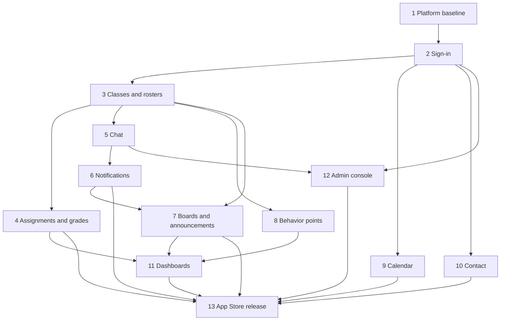

# Epic map

This lists which epic owns each table, shared check, function, bucket, topic and job in the [architecture spine](architecture-capacitor-supabase-port.md). The owner writes the migration, policies, privilege-fixture entries and tests. Other epics only use what is listed under "Uses". Where an object is created as a stub and filled in by a later epic, the map says so. AD numbers refer to the spine.

## Ownership

| Epic | Owns | Uses |
| --- | --- | --- |
| 1 Platform baseline | `app/` shell; `app/src/api/` client and error map (AD-17); schemas `app` and `internal`, created empty; `internal.job_failures`; the privilege fixture and the pgTAP catalog test (AD-3); `deploy.yml` with the Auth config push, the Realtime private-only setting and the config health check (AD-21); `test.yml`; `keep-alive.yml`; `backup.yml`; `wrangler.jsonc`; live-update packaging and `latest.json` with `min_native_build` (AD-18) | My-Love's deploy, live-update and test layout |
| 2 Sign-in | `profiles` and its column grants (AD-6, AD-12); `staff_invites`; `internal.before_user_created` and `internal.on_auth_user_created`; bootstrap admin in Vault; `app.my_role`, `app.is_admin`; `app.can_see_user` as the AD-2 union, with stub clauses; `app.visible_email`; `touch_presence`; `notifications` and `internal.notify` (inbox write, AD-14); `audit_events` and `internal.audit` (AD-22), logging staff invite changes; the `user:` topic and `app/src/api/realtime.ts`; the upload pattern and the `avatars` bucket; `internal.storage_deletions` and `sweep-storage` (AD-13, AD-16); `apple-secret.yml`; landing and sign-in screens | Epic 1 pipeline |
| 3 Classes and rosters | `classes` (`archived_at`), `enrollments`, `delete_class`; `app.teaches`, `app.enrolled`, `app.class_open`, `app.teaches_student`, `app.shares_class` (fills epic 2's class clauses); `add-students`, `reset-student-password`, `reveal_student_password`, `student_credentials`, the password-change trigger and `internal.password_resets` (AD-8); `internal.enroll_student_as`; roster status and the printable sheet; remove student; removal-request rows and the `removal_request` notification | `profiles`, `notify` (2) |
| 4 Assignments and grades | `assignments`, `submissions`, `grades`; the grade-summary function (GPA, letters, averages); analytics and archived-grade views; `assignment-files` and `submission-files` buckets with their delete triggers; Drive copy-in and the iOS picker spike; `reminder_preferences` and the due-reminder job (AD-15) | class checks (3), upload pattern (2), `notify` (2) for `assignment_published`, `grade_posted` and `due_reminder` |
| 5 Chat | `chats`, `chat_members`, `chat_reads`, `messages`, `scheduled_messages`; `app.in_chat` and the chat co-membership clause of `app.can_see_user`; `internal.send_message_as`, `mark_chat_read`; `internal.message_recipients`; the class-chat trigger and backfill (AD-9); `chat-files` bucket and its delete trigger; `chat:` topics and typing Presence; the scheduled-message job; presence dots | enrollments and checks (3), directory and upload pattern (2), `user:` topic (2) |
| 6 Notifications | `push_devices`, `register_push_device`, `unregister_push_device`; `internal.push_targets`; `send-push` (APNs, web push, DND skip, gone-token cleanup); the `AFTER INSERT` delivery triggers on `notifications` and `messages`; the `notification` event on `user:`; web pop-up (R17); inbox screen (R14); web push service worker | `notify` and `notifications` (2), `internal.message_recipients` (5), `profiles.dnd` (2) |
| 7 Boards and announcements | `boards`, `threads`, `replies`, `likes`; the Announcements board trigger and backfill (AD-9) | class checks (3), `notify` (2) for `announcement`, delivery (6) |
| 8 Behavior points | `behaviors`, `points_history`; award and undo functions; totals functions | class checks (3) |
| 9 Calendar | `calendar_events`, `calendar_event_participants`, `add_event_participant` | `app.can_see_user` (2) |
| 10 Contact | `support_reports`; admin reports list; Gmail compose link | `app.visible_email` (2) |
| 11 Dashboards | `security_invoker` views for widgets and recent activity; writes nothing | tables of epics 4, 7 and 8; grade-summary function (4) |
| 12 Admin console | `delete-account` and every deletion path (AD-16); the deletion test file; user list with counts by role and online; staff list management | `profiles`, `staff_invites` (2), presence (5), removal requests (3) |
| 13 App Store release | App Review submission with demo accounts on the lists; removal of Flutter, Firebase, `functions/`, `src/index.js`, the old workflows and the Pages project | everything |

## Seams to watch

| Seam | Between | Contract |
| --- | --- | --- |
| Profile creation | 2 ↔ 3 | `on_auth_user_created` (2) is the only profile writer; `add-students` (3) sets `app_metadata.fermi_role = 'student'` through the admin API and never writes `profiles` (AD-6) |
| Staff versus student emails | 2 ↔ 3 | `add-students` refuses staff-list and bootstrap emails; `staff_invites` refuses existing student emails (AD-7, AD-8) |
| Directory clauses | 2 → 3, 5 | epic 2 ships `app.can_see_user` with `false` stubs; epic 3 replaces the class clauses and epic 5 the chat clause; no one else edits it (AD-2) |
| Archived classes | 3 → 4, 5, 7, 8 | every class-scoped write checks `app.class_open`; reads follow AD-2's truth table (AD-9) |
| Removal from a class | 3 → 4, 5, 7, 8 | removing an enrollment ends access to everything scoped to that class; groups drop the student through `app.in_chat`, with no cleanup write (AD-9, AD-10) |
| Companion rows | 3 → 5, 7 | the class chat and the Announcements board come from `AFTER INSERT ON classes` triggers plus backfill, one per class (AD-9) |
| Inbox before delivery | 2 → 3, 4, 7 → 6 | emitters call `internal.notify` from epic 2; push and the pop-up start working when epic 6 ships (AD-14) |
| Message recipients | 5 → 6 | `send-push` gets recipients only from `internal.message_recipients` through `internal.push_targets` (AD-1, AD-14) |
| `user:` events | 2 → 5, 6 | each event type is added to `realtime.ts` by the epic whose trigger emits it (AD-19) |
| Upload and file cleanup | 2 → 4, 5 | bucket table, path checks, signed URLs under 1 hour; each bucket owner adds an `AFTER DELETE` trigger into `internal.storage_deletions` (AD-13, AD-16) |
| Audit log | 2 → 3, 12 | class, roster, password and removal-request actions (3) and account deletions (12) call `internal.audit` in the same transaction (AD-22) |
| Delete cascade | 12 ↔ all | each table's foreign key to `profiles` follows AD-16's cascade rule in its own migration, and each epic adds its case to epic 12's deletion test file |
